# Data Strategy for LLMs
*Published by Packt*

A comprehensive guide to implementing data strategies for Large Language Models, covering everything from environment setup to advanced RAG implementations.

### OpenAI API Setup

For this book, I'm using OpenAI's API as our primary LLM provider. While there are other excellent options like Anthropic's Claude, Google's Gemini, or even local models with Ollama, OpenAI provides the most reliable, well-documented, and widely-used API in the industry. The reason I choose OpenAI for this book is the predictable service quality, comprehensive model selection, and industry-standard experience that you'll encounter in production environments. However, you can adapt the code to work with any other API of your choice. LLM calls are not the focus of this book, but are necessary. The focus of this book is about the data we are feeding to the LLM.

Here's the step-by-step setup process:

**Step 1: Create Your OpenAI Account**

When you go to https://platform.openai.com, you will see the following screen, where you can Sign In or Sign Up. If you have an account, you just need to sign in. If you don't have account, you need to sign up. Go to https://auth.openai.com/create-account and sign up for an account. You'll need to provide a phone number for verification.

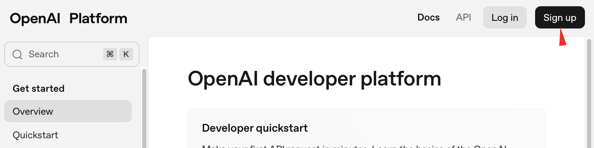
**Figure 1.5: OpenAI Platform homepage - the industry standard for LLM APIs**

**Step 2: Complete Account Verification**

You can sign up with Google, Microsoft, or email. OpenAI requires phone verification for security. I recommend using your primary development account for consistency.

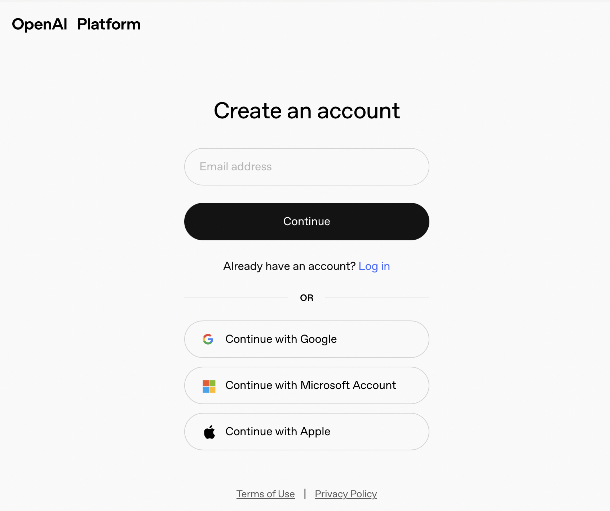

**Figure 1.6: OpenAI registration - phone verification required for account security**

**Step 3: Add Billing Information**

OpenAI API usage is billed separately from ChatGPT subscriptions. The book's shared model selector discovers and tests approved low-cost models at runtime, preferring GPT-4o-mini and GPT-4.1-mini. It never automatically falls back to premium or unpriced models, including choices left in an older cache. If no budget model works, it stops with a clear error instead.

Allow **$5 in API credit for one pass through the bundled examples** using this budget policy. This is a planning estimate, not a hard spending cap: reruns, reasoning tokens, retries, and evaluation-library calls can increase usage. Chapter 7 trains locally and has no OpenAI training charge. Check [current OpenAI pricing](https://developers.openai.com/api/docs/pricing) and monitor your API usage. Model prices and availability can change.

`BASE_MODEL` can express a preference among approved budget families when using `utils.notebook_setup.setup`; it cannot enable premium models. The curated family list lives in `utils/models.py` so notebooks continue to discover available models rather than pinning a model name.

**Important**: **You will have to add money to your credit balance to be able to run the examples in this book. If you did not add credit, you will receive an error when you call the APIs.** 
https://platform.openai.com/settings/organization/billing/overview 

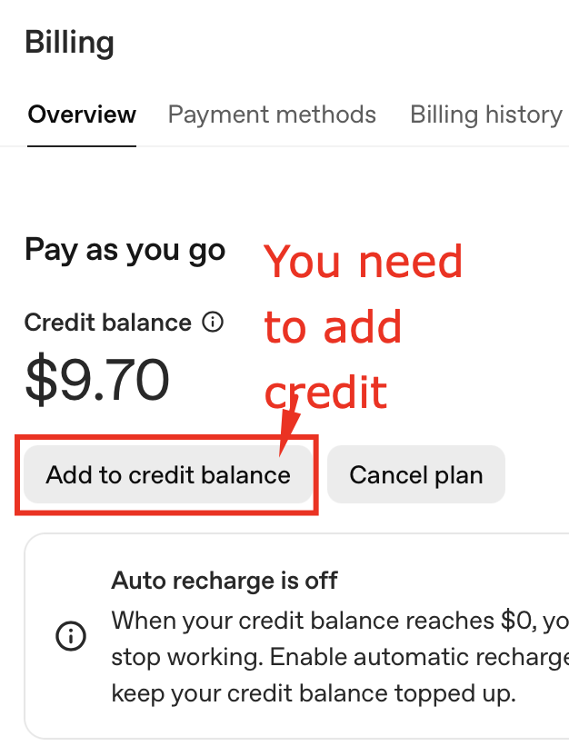

**Figure 1.7: Billing setup - pay-per-use model with transparent pricing**

**Step 4: Navigate to API Keys**

Once your account is set up, go to https://platform.openai.com/api-keys to manage your API keys.

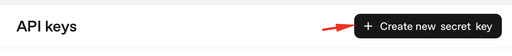

**Figure 1.8: API Keys section in your OpenAI dashboard**

**Step 5: Create Your API Key**

Click "Create new secret key" and give it a descriptive name like "Book Examples" or "Development Testing". 

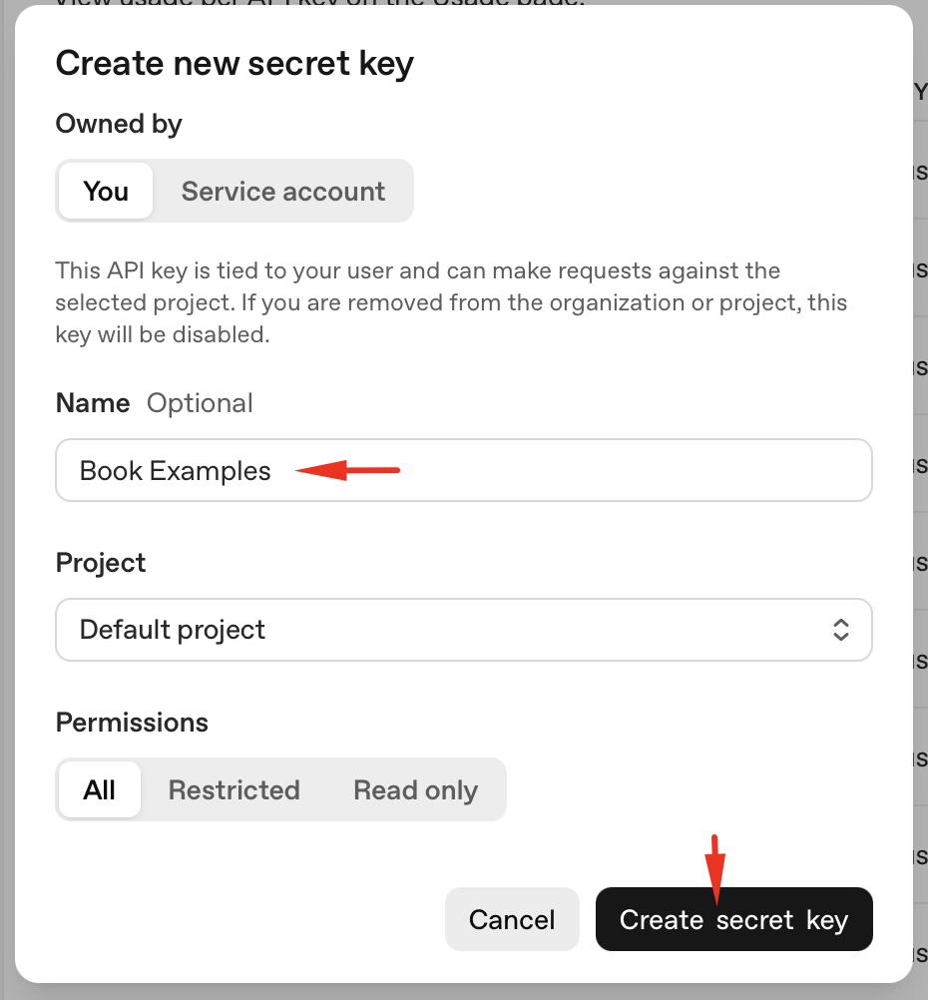

**Figure 1.9: Creating a new API key**

**Step 6: Copy Your API Key**

Your API key will start with "sk-" - copy the entire string and paste it in the pop-up window in Colab.

- Store it securely. **Important**: You can only view this key once, so save it immediately.

## Quick Start

### 1. API Key Setup (One-time)
```bash
# Copy the template and add your API keys
cp .env.example .env
# Edit .env with your actual API keys (OpenAI, OpenRouter, etc.) with the APIkey you created in the previous step.
```

### 2. Environment Setup (One-time)
**macOS/Linux:**
```bash
bash setup/setup_mac.sh
```

**Windows (PowerShell):**
```powershell
powershell -ExecutionPolicy Bypass -File setup/setup_windows.ps1
```

### 3. Activate Environment
**macOS/Linux:**
```bash
source data_strategy_env/bin/activate
```

**Windows (PowerShell):**
```powershell
.\data_strategy_env\Scripts\Activate.ps1
```

### 4. Use in Jupyter Notebooks
- Select kernel: **"Python (Data Strategy Book)"**
- If kernel not visible: Command Palette → "Developer: Reload Window" (Mac: Cmd+Shift+P, Windows: Ctrl+Shift+P)

- Open Command Palette (Mac: Cmd+Shift+P) (Windows: Ctrl+Shift+P), 
- run: Developer: Reload Window (Mac: Cmd+Shift+P; or press Cmd+P, type '>Developer: Reload Window (Windows: Ctrl+P, type '>Developer: Reload Window')')

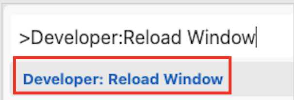

- After reload, click Select Kernel (top-right)

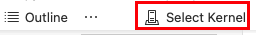

- Choose Jupyter Kernel

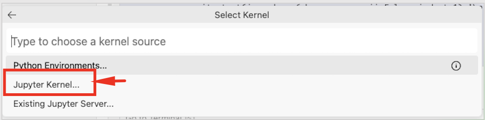

- Choose `Python (Data Strategy Book)`

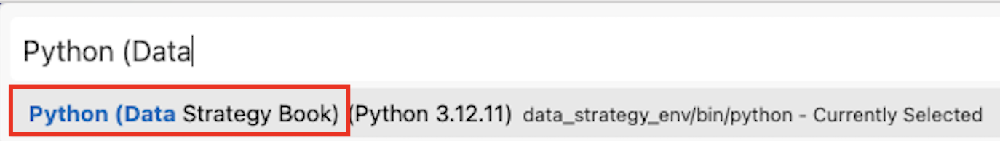

- Run ALL cells:

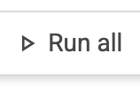

- If you did not add the API key to the .env file, or during the setup, you will receive a pop-up to enter your OpenAI API key

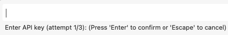

We already explained how to get an OpenAI API key in the first section of this README.

## What Gets Created
- **Shared environment**: `data_strategy_env/` (the newest supported Python on your machine, 3.10 or later)
- **Jupyter kernel**: "Python (Data Strategy Book)"
- **API keys**: Loaded automatically from `.env` file
- **All dependencies**: Consolidated across all chapters

## Chapter Structure
Each chapter contains:
- `Jupyter_Notebooks/` - Interactive notebooks
- `README.md` - Chapter-specific instructions
- Supporting data files and resources

## Requirements
- Python 3.10 or newer (the setup script finds the newest supported version on your machine and installs one if needed)
- OpenAI API key (required for most chapters)
- Optional: OpenRouter, Anthropic API keys for advanced features

## What changed since the book was printed

The book is fixed on paper, but the notebooks are not. Models get renamed or retired, prices move, and libraries change their APIs, so we keep updating the notebooks to keep them running. When the notebook and the printed page disagree, the notebook is the current version. This section lists every change that affects what you see on the page, newest first, so a mismatch has an explanation instead of looking like a bug.

<!-- Maintainers: add new entries at the top. Give the date, the chapter and notebook part, what the notebook does now, and what the reader will see differently from the printed page. -->

**October 2026 - All chapters: how the notebooks choose a model.** The notebooks pick a model at runtime from a short list of approved low-cost models (`MODEL_PRIORITY` in `utils/models.py`) and never fall back to a premium model. Many printed outputs came from runs with other models, so the wording, the scores, and the occasional refusal will differ in your run. That is expected. The method is the lesson, not my exact numbers. Two places where you will notice it most:

- **Chapter 9, Part 3, Step 4 (Compare generators):** the printed table shows `gpt-5.5` as the strong control. In your run, the control is the low-cost model the notebook selected, so the gap between it and the older models may be smaller than the one in the book.
- **Chapter 1, the "Who is Rany ElHousieny?" example:** the printed output came from an older model, and the chapter explains why I kept it. Whether your run knows the name depends on which model the notebook selected.

**October 2026 - Chapter 9, Part 1 (RAG evaluation).** The `book_collection` this part evaluates is built by the **Chapter 3** notebook. If your copy of the book says to run Chapter 4 first for this section, run Chapter 3 instead. The notebook now loads `book_collection` only when it holds Chapter 3's `id_0` to `id_3` documents. Otherwise it builds a small stand-in collection from the same four documents, so the section always runs. Your listing will show either your Chapter 3 store or those four documents, not the 24 entries printed in the book.

**October 2026 - Chapter 4, the LangChain example.** The notebook's LangChain cell reads the shared store at `data/chroma_db` and uses the model the notebook selected at runtime. If your printed copy shows `persist_directory="db"` or a fixed model name, use the notebook version.

## Troubleshooting
- **Kernel not showing**: Reload VS Code/Jupyter and reopen notebooks
- **API key errors**: Ensure `.env` file is in repository root with valid keys
- **Import errors**: Verify you're using the "Python (Data Strategy Book)" kernel

## Support
For issues or questions, refer to individual chapter READMEs or the book's official resources.
